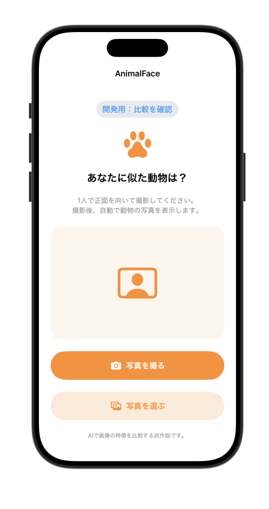

# 日専祭アプリ：（アプリ名をここに書く）

> **学籍番号　。　氏名:**
> 26CM0131 ミャテインギーテイン
> **チーム名**
> SyncThree
> **AI利用レベル：** 2（生成コード可）
> **最終更新：** 2026-10-02
> **チーム: ** SyncThree (26CM0132 ミャッモンモンセン、26CM0124 ナンダーウー、26CM0131 ミャテインギーテイン)

> 💡 制作の進め方は担任の先生から案内があります。このファイルの項目は、担任の先生の指示で増えることがあります。

---

## 何ができるアプリか（3行）

（例：買い物リストを作るアプリ。品名を入力して追加できる。買ったものにチェックを付けると一覧から消える。）

## 画面

## 使った文法・技術

（例：`@State`、`List`、`ForEach`、構造体、配列の `append` と `remove`）

@State：画面の状態や選択した写真を管理する。

struct：画面やデータの構造を定義する。

SwiftUI：アプリの画面を作成する。

PhotosPicker：写真ライブラリから写真を選択する。

Vision・CoreML：画像の特徴を分析し、似ている動物の写真を探す処理に使用する。

## 生成AIの使い方（どの場面で、どう使ったか）

（例：画面の骨組みは ChatGPT に書いてもらった。削除ボタンが効かなかったので、原因を質問して直した。）

ChatGPTでコードの説明を聞いたり、エラーの修正方法を調べたりしました。

## 展示で工夫した点

（例：文字を大きくして、来場者が操作しやすいようにした。）
画面をシンプルにして、誰でも使いやすいデザインにした。
